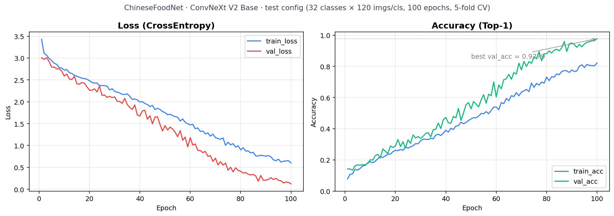

# ChineseFoodNet 美食分类

基于 **PyTorch + timm + ConvNeXt V2** 的 208 类中餐图像分类项目，包含训练、验证、单图推理、Gradio 演示，以及 FastAPI Web 应用。输入尺寸为 224 × 224。

本仓库提供代码、类别名称与历史实验资料。**数据集、预训练权重与训练后的权重需自行准备**；历史日志不代表完整 208 类独立测试集上的最终成绩。

## 数据集来源

本项目使用 **ChineseFoodNet** 数据集，官方网站：[ChineseFoodNet](https://sites.google.com/view/chinesefoodnet/)。请从官网查看数据集介绍、获取方式及使用要求；本仓库不重新分发数据集图片。下载后按 [数据说明](data/README.md) 整理目录，并核对类别与标签的对应关系。

## 项目结构

```text
chinesefoodnet-classification/
├── .github/workflows/ci.yml       # 整个仓库的自动检查
├── data/
│   ├── metadata/class_names.csv   # 唯一类别字典
│   └── README.md                 # 数据准备与类别排序约定
├── food-classifier/              # 模型训练与离线推理
│   ├── configs/                  # 完整训练与小规模实验配置
│   ├── src/                      # train / evaluate / infer / app / dataset / config
│   ├── scripts/                  # 训练、监控、演示启动器
│   ├── Dockerfile
│   └── requirements.txt
├── food-web/                     # FastAPI 与静态前端
│   ├── server.py
│   ├── inference.py
│   ├── static/
│   ├── scripts/
│   └── requirements.txt
├── docs/                         # 架构审查、模型说明、发布指南
├── reports/
│   ├── experiments/legacy/       # 已有训练 CSV
│   └── figures/                  # 已有训练曲线
├── tests/                        # 路径、类别与 Web 接口回归测试
├── pyproject.toml                # Ruff / pytest 统一配置
├── requirements-dev.txt
└── README.md
```

`data/processed/`、`outputs/`、`checkpoints/`、`logs/` 和下载的 `bin/` 为本地目录，已加入 Git 忽略规则。两个应用分别保留依赖清单；当前采用脚本式项目，无需 `pip install -e .`。

## 快速开始

建议使用 Python 3.11。以下命令从仓库根目录运行。

```bash
python -m venv .venv
# Windows PowerShell: .venv/Scripts/Activate.ps1
# Linux / macOS: source .venv/bin/activate
python -m pip install -r food-classifier/requirements.txt
```

按 [数据说明](data/README.md) 准备 train/val 目录，检查类别顺序，然后运行：

```bash
python food-classifier/src/train.py --config food-classifier/configs/convnextv2_base.yaml
python food-classifier/src/evaluate.py
python food-classifier/src/infer.py --image path/to/food.jpg --top-k 5
python food-classifier/src/app.py
```

默认配置使用全部类别与固定验证集，首次训练由 timm 获取预训练权重。超参数是起始配置，未宣称达到特定准确率。YAML 内的相对路径统一以 **YAML 所在目录**为基准；个人设置可放入 `configs/*.local.yaml`，不会提交。

输出位于 `outputs/convnextv2_base/`：`best.pth` 用于推理，`latest_checkpoint.pth` 用于恢复训练，`logs/` 保存 CSV 和 TensorBoard 记录。更多选项见 [训练说明](food-classifier/README.md)。

## Web 应用

训练完成后，Web 默认直接读取上述 best.pth，无需复制。

```bash
python -m pip install -r food-web/requirements.txt
python -m uvicorn server:app --app-dir food-web --host 127.0.0.1 --port 8000
```

访问 <http://127.0.0.1:8000>；接口文档位于 `/docs`。已有权重可通过环境变量 `CKPT_PATH` 指定绝对路径。更多参数见 [Web 说明](food-web/README.md)。现有服务在权重缺失时使用随机参数并返回警告，这种状态仅供调试，预测没有分类意义。

## 实验资料

已保留 [历史训练 CSV](reports/experiments/legacy/history.csv) 和原有曲线，未重新训练或据此编造结果。图片与 CSV 是否来自同一次运行仍需核对。



实验限制和待补充信息见 [模型说明](docs/model-card.md)。

## 开发检查

```bash
python -m pip install -r requirements-dev.txt
python -m ruff check .
python -m pytest -q
python -m compileall -q food-classifier/src food-web tests
```

根目录 GitHub Actions 执行核心检查。接口测试使用小型假模型，不下载权重，不替代真实模型评估。

## 设计参考与发布

- [PyTorch examples / ImageNet](https://github.com/pytorch/examples/tree/main/imagenet)：清晰的训练入口与运行说明。
- [Cookiecutter Data Science](https://github.com/drivendataorg/cookiecutter-data-science)：分离代码、数据、实验报告与生成产物。

采用适合本项目体量的双模块结构。职责、迁移记录和待改进项见 [架构审查](docs/architecture.md)；上传步骤见 [GitHub 发布指南](docs/publishing.md)。

## 许可

代码许可证尚未指定，未代选 MIT 或其他授权。发布者应自行决定代码许可证；数据集与预训练权重的授权需分别确认。
